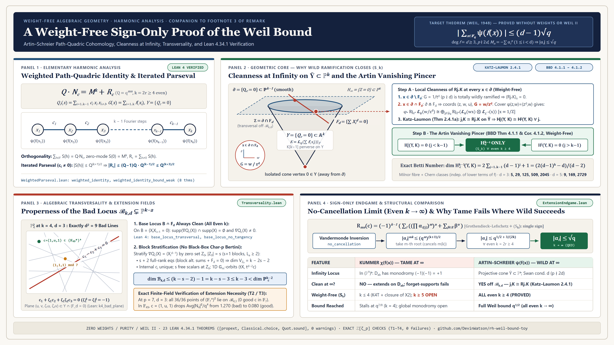

# A toy "sign-only" route to the Weil bound

This repository contains **two companion studies** of the path-quadric "sign-only" route ($q N = M ^ k + R$) sketched in footnote 3 of the note "Remark" (https://alpo.ge/remark.pdf, November 2026). The note is not reproduced here. Nothing in this repository says anything about the Riemann Hypothesis for the integers; both studies concern classical finite-field character/exponential sums where Weil (1948) is already a theorem.

---

## 1. Kummer / Hyperelliptic Version (`y^2 = f(x)`, root directory)

**Status (updated 2026-11-22): a proof on paper for all $k$ with no known gap, reduced to named standard theorems; not a theorem. It has not been read by a mathematician, and its cohomological half is not machine-checked.** Studies $t(x) = \chi(f(x))$ for odd squarefree degree $d \ge 3$ over odd $\mathbb{F} _ q$. Four rounds:

- **Round 1** ([TOY_CASE.md](TOY_CASE.md)). Proved: the identity $q N = M ^ k + R$, the bound on $R$ from $k - 1$ Parseval steps, and "no cancellation implies $|\alpha| \le q ^ {1/2 + 3/(2k)}$". Left open: the cohomological vanishing input $(S _ k)$ for $k \ge 4$.
- **Round 2** ([round2/ROUND2.md](round2/ROUND2.md)). $(S _ 4)$ proved without weights for coefficients in general position, which reaches $q ^ {7/8}$. $(S _ k)$ is false for some quadrics: at $k = 4$ whenever $c _ 1 + c _ 2 + c _ 3 = 0$ (this includes the plain all-ones quadric in characteristic 3), and more generally on planes that come from multiplicative symmetries of the roots of $f$. For $k \ge 5$ the forget-supports route fails: tame monodromy $-1$ at infinity cancels in pairs $(-1)(-1) = +1$ along non-adjacent boundary divisors $D _ {ab} \subset (\mathbb{P} ^ 1) ^ k$.
- **Round 3** ([round3/PROOF_DRAFT.md](round3/PROOF_DRAFT.md), steps S0 to S12). A route that does not need $(S _ k)$, and uses no weights:
  1. *Fibre statement.* For coefficients $c$ in general position and every $h \ne 0$, the fibre sum $S _ h$ has cohomology in one degree. The argument is an induction over $k - 1$ rounds of "$\ell$-adic Fourier transform, then tensor with the character sheaf", in which the sheaf stays irreducible perverse because the singular points of each transform avoid the roots of $f$. The condition on $c$ involves ratios of the $c _ i$ and of the roots, not $h$; the plain all-ones quadric fails it from $k = 5$ on, so the coefficients are needed.
  2. *Dichotomy in place of the sign statement.* A $k$-fold product of eigenvalues either is not cancelled in $q N = M ^ k + R$, and is then bounded by the bound on $R$; or it is cancelled, and then equals $q$ times an eigenvalue on a constant quotient of the family over $h$, which is bounded inside a single fibre by Parseval. Either way $|\alpha| ^ k \le q ^ {(k+3)/2}$, and $k \to \infty$ gives $|\alpha| \le \sqrt q$.
- **Round 4** ([round4/MAIN_SESSION_CHECK.md](round4/MAIN_SESSION_CHECK.md), [round4/PROOF_V2.md](round4/PROOF_V2.md), [round4/LEMMA_R.md](round4/LEMMA_R.md)). Laumon's 1987 paper was read from clean page images. The induction of round 3 was re-derived twice from those pages, and a hostile referee agent found no fatal error. Its one repairable item (a local-global comparison used at points where the paper states it only at the origin) is removed by `LEMMA_R.md`: the four facts the induction needs about each transform (rank, place and size of the drops, tameness at finite points, the Artin-Schreier-times-tame blocks at infinity) follow from the Euler-Poincare (Grothendieck-Ogg-Shafarevich) formula applied in both directions of the transform. A second referee agent found that lemma to hold as written. The lower bound (duality) is written out, with an exact check of the symmetry of the L-polynomial. The Lean files now cover arbitrary nonzero coefficients and a field that depends on $k$ (34 theorems).
- **Not done.** No mathematician has read it. Nobody in this project read, at a source, the proof of the Grothendieck-Ogg-Shafarevich formula (now the main tool of the induction), the inner proofs of the Grothendieck trace formula, or the $\overline{\mathbb{Q}} _ \ell$ formalism behind base change and duality; BBD chapter 4 and Katz-Laumon 2.1.3 were read from OCR text only. The exact tests are Euler-characteristic counts and reach no case with degree $\ge 3$ and $k \ge 3$. The Lean files cover the elementary half only: the identification of $R$ with a signed sum of Frobenius eigenvalues is a hypothesis there, and Mathlib has no etale cohomology of sheaves to state it in. Whether the route is new is undecided.

Start with [round4/MAIN_SESSION_CHECK.md](round4/MAIN_SESSION_CHECK.md) for the current state, [round4/PROOF_V2.md](round4/PROOF_V2.md) together with [round4/LEMMA_R.md](round4/LEMMA_R.md) for the proof, and [TOY_CASE.md](TOY_CASE.md) for the setting.

## 2. Artin–Schreier Companion Version (`t(x) = psi(f(x))`, `artin-schreier-toy-case/`)

**Status: closes weight-free for all even $k \ge 4$, yielding the full Weil bound $|\sum _ {x \in \mathbb{F} _ q} \psi(f(x))| \le (d - 1)\sqrt{q}$ ($d \ge 3$, $p \nmid 2d$).**

Replacing the tame Kummer sheaf $\mathcal{L} _ \chi(f)$ with the wildly ramified Artin–Schreier sheaf $\mathcal{L} _ \psi(f)$ restores **cleanness at infinity** ($j _ ! K \cong R j _ * K$) on the projective quadric cone $\overline{Y} \subset \mathbb{P} ^ k$ whenever $\{Q _ c = 0\}$ intersects $\{X _ 1 ^ d + \dots + X _ k ^ d = 0\}$ transversally in $\mathbb{P} ^ {k-1}$:

- **Weight-free $(S _ k)$ for all even $k \ge 4$:** proven via Katz–Laumon (1985) Appendix 2.4 (`Thm 2.4.1`, weight-free) + BBD Artin vanishing (`4.1.1–4.1.2`, weight-free), with an elementary proof that the non-transversal locus $\mathcal{B} _ {k, d} \subset \mathbb{P} ^ {k-2} _ c$ has dimension $\le k - 3 < k - 2$ (and equals exactly the $d ^ 2$ lines $c _ 1 + \zeta _ 1 c _ 2 + \zeta _ 1 \zeta _ 2 c _ 3 = 0$, $\zeta _ i ^ d = -1$, at $k = 4$).
- **Closed-form middle Betti number for all even $k \ge 2$:** $\dim H ^ {k-1} _ c(Y, K) = 2 \sum _ {j=1} ^ {k-1} (d - 1) ^ j + 1$ ($5, 29, 125, \dots$ for $d = 3$).
- **Upgraded Lean 4.34.1 formalization (23 theorems, zero warnings, standard axioms only):** generalizes `ToyWeil` to arbitrary nonzero weights $c _ i \ne 0$, arbitrary unbounded subsequences of $k$, and $k$-dependent extension fields $\mathbb{F} _ {q ^ m}$ (necessary already at $k = 4, d = 3, p = 7$, where all 36 points of $(\mathbb{F} _ 7 ^ *) ^ 2$ lie on $\mathcal{B} _ {4, 3}$), plus machine-checked algebraic transversality proofs.
- **Forensic review of the Kummer study** ([artin-schreier-toy-case/REVIEW_OF_TOY_CASE.md](artin-schreier-toy-case/REVIEW_OF_TOY_CASE.md)): includes an unconditional weight-free closure of Round 2 `K4T`'s open exception `(X2)` ($f(x) = x ^ d - a$) and an exact symmetry-group explanation of `K4C`'s coincidence `(iv)`.

Start with [artin-schreier-toy-case/ARTIN_SCHREIER_TOY_CASE.md](artin-schreier-toy-case/ARTIN_SCHREIER_TOY_CASE.md).

*Proof overview poster ([4K PNG](artin-schreier-toy-case/artin_schreier_proof_infographic.png) · [scalable vector SVG](artin-schreier-toy-case/artin_schreier_proof_infographic.svg)).*

---

## Contents

| Path | What |
|---|---|
| [TOY_CASE.md](TOY_CASE.md) | Kummer round 1 write-up, with every step labelled `PROVED`, `CITED`, `CHECKED`, `OPEN` or `HINT` |
| [reports/](reports/) | Round 1 reports (derivation, two computations, referee, vanishing analysis, literature, archive read) |
| [compute/](compute/) | Round 1 scripts and exact outputs; `compute/main-session-check/` holds the independent spot checks of all four rounds |
| [round2/](round2/) | Round 2: `ROUND2.md` (synthesis), `MAIN_SESSION_CHECK.md`, `BRIEF.md`, nine reports and their scripts and outputs |
| [round3/](round3/) | Round 3: `PROOF_DRAFT.md` (steps S0 to S12), `ROUND3.md`, `MAIN_SESSION_CHECK.md`, `BRIEF.md`, nine reports and their scripts and outputs |
| [round4/](round4/) | Round 4: `MAIN_SESSION_CHECK.md` (current state), `PROOF_V2.md` (the assembled proof), `LEMMA_R.md` (the induction step from rank counts), `BRIEF.md`, nine reports (seven workers, the hostile referee, the referee of Lemma R) and their scripts and outputs |
| [lean/ToyWeil/](lean/ToyWeil/) | `Parseval.lean`, `PowerSum.lean`, `Identity.lean`, `Endgame2.lean`, `Weighted.lean`, `Unbounded.lean`: 34 theorems with their axioms printed in `lean/logs/`, Lean 4.34.1 with Mathlib, axioms `propext`, `Classical.choice`, `Quot.sound` (`Smoke.lean` only tests the toolchain) |
| [NOT_IN_REPO.tsv](NOT_IN_REPO.tsv) | Four exact data tables over 1 MB and three compiled test programs that are left out, with sizes and SHA-256; the scripts and the two C sources beside them regenerate them |
| [tools/](tools/) | Helper scripts for the Kummer study; some refer to a local copy of the Lean archive of the note, which is not included |
| [artin-schreier-toy-case/ARTIN_SCHREIER_TOY_CASE.md](artin-schreier-toy-case/ARTIN_SCHREIER_TOY_CASE.md) | Artin–Schreier companion write-up proving the Weil bound weight-free for all even $k \ge 4$ |
| [artin-schreier-toy-case/artin_schreier_proof_infographic.png](artin-schreier-toy-case/artin_schreier_proof_infographic.png) | Proof overview infographic poster (4K PNG; vector source in [artin_schreier_proof_infographic.svg](artin-schreier-toy-case/artin_schreier_proof_infographic.svg)) |
| [artin-schreier-toy-case/REVIEW_OF_TOY_CASE.md](artin-schreier-toy-case/REVIEW_OF_TOY_CASE.md) | Forensic review of the Kummer study, closing exception `(X2)` and resolving coincidence `(iv)` |
| [artin-schreier-toy-case/compute/](artin-schreier-toy-case/compute/) | Exact cyclotomic-ring $\mathbb{Z}[\zeta _ p]$ DP/Segre scripts and verified outputs (`t1`–`t4`, 0 failures) |
| [artin-schreier-toy-case/lean/ArtinSchreierToy/](artin-schreier-toy-case/lean/ArtinSchreierToy/) | `WeightedParseval.lean`, `ExtensionEndgame.lean`, `Transversality.lean`: 23 theorems, Lean 4.34.1 with Mathlib, axioms `propext`, `Classical.choice`, `Quot.sound` |
| [artin-schreier-toy-case/tools/lean_check.sh](artin-schreier-toy-case/tools/lean_check.sh) | Portable Lean 4 build/check script for `ArtinSchreierToy` |

## Caveats

- Both versions were produced by AI agents (the Kummer study by Claude; the review and Artin–Schreier companion study by Antigravity / Gemini) and have not been refereed by a mathematician.
- In the Kummer Round 1 study, the literature search worked from search summaries, so "known or new" is undecided and cited statement numbers need checking against primary texts. In the Artin–Schreier study, the weight-free status of BBD 4.1.1–4.1.2 and Katz–Laumon Appendix 2.4 (`Thm 2.4.1`, `2.4.4`) was checked against the primary papers, while the `l`-adic cohomology steps remain paper proofs (not formalized in Lean).
- The Round 4 material refers to page images of Laumon's 1987 paper and to reading notes on it. Those are not in this repository; statements of that paper are given in the agents' own words with statement number and journal page.
- In the Kummer Round 2 and Round 3 material, the reports and briefs refer to files that are not in this repository: the text of the note (`FOOTNOTE.md`), and papers and text dumps of papers that the agents fetched to read (`round2/compute/LIT/`, the PDF and text files of `round3/compute/D/`). Statement numbers quoted from those papers were read from OCR text in several cases and need checking against the printed pages.
- Scripts were written for one machine; paths have been made relative and may need adjusting (e.g. `MATHLIB_DIR` for `lean_check.sh`).
- No licence has been chosen yet.
